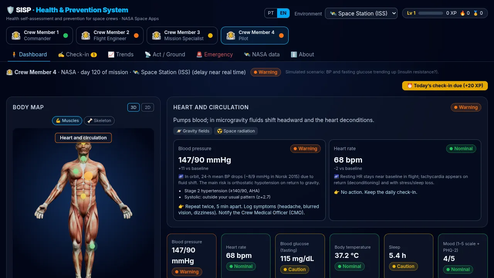
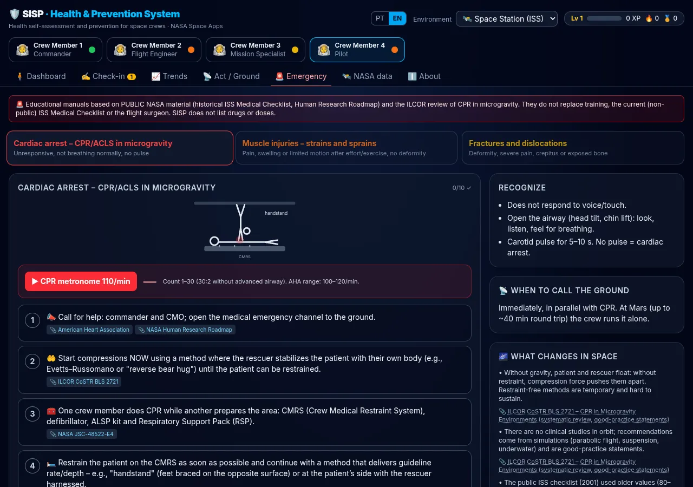
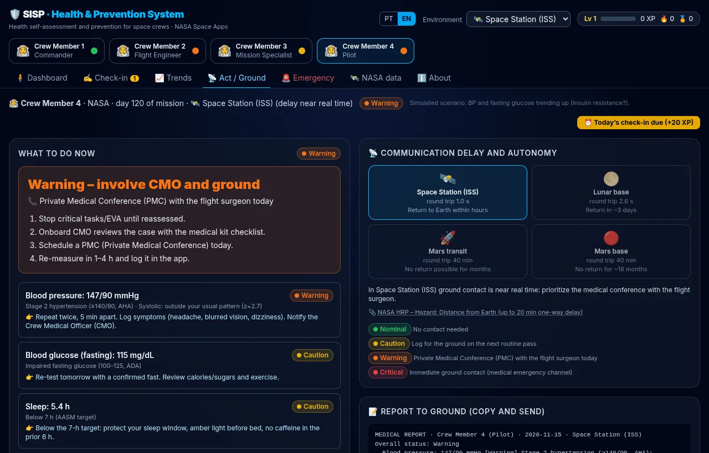

<div align="center">

# 🛡️ SISP — Health & Prevention System

**Offline-first health self-assessment and emergency guidance for astronauts**

NASA Space Apps Challenge · *Create Health Monitoring Software for Astronauts on Space Missions*

[Português](README.pt.md) · English


</div>

> [!WARNING]
> **SISP is not a medical device and not a NASA protocol.** It is an educational hackathon prototype.
> Clinical ranges come from published terrestrial guidelines (AHA, NHLBI, ADA, CDC, AASM, PHQ-2) and public NASA material;
> the operational limits used by NASA flight surgeons are not public. Personal-baseline thresholds are prototype heuristics and all crew data is **simulated**.
> Emergency manuals are summaries of public NASA documents and do not replace training, the current (non-public) ISS medical checklist, or a flight surgeon.



## Overview

On a long mission, the crew cannot always wait for the ground. SISP lets each astronaut log six vital indicators in under a minute, see on a 3D body **which system is drifting**, and get a clear answer to two questions: **what do I do now?** and **when do I call the ground?** The answer adapts to where the crew is: the ISS (near real-time link), the Moon, or Mars (up to ~20 min one-way delay).

## Features

| | |
|---|---|
| 🧍 **Interactive 3D body** | Muscular and skeleton `.glb` models (React Three Fiber). Rotate, zoom and click per-region hotspots colored by severity. A 2D SVG body map is available as a fallback. |
| ✍️ **Daily check-in** | Blood pressure, heart rate, fasting glucose, body temperature, sleep, and mood (1–5 scale + PHQ-2), each with measurement instructions. |
| 🧠 **Two-layer assessment** | (1) absolute limits from published guidelines; (2) deviation from the astronaut's **personal 14-day baseline** (z-score). Output: *Nominal / Caution / Warning / Critical*. |
| 🌡️ **Relative fever** | Resting core temperature rises ~1 °C in flight (Stahn 2017), so SISP warns at +0.8 °C over *your* in-flight baseline, even below 38 °C. |
| 📡 **Delay-aware escalation** | Guidance and a copy-ready report for the ground that adapt to the selected environment (ISS, lunar base, Mars transit, Mars base). |
| 🚨 **Emergency manuals** | Step-by-step guides for **cardiac arrest (CPR/ACLS in microgravity)**, **muscle injuries** (strains/sprains) and **fractures/dislocations**, with illustrations, a 110/min CPR metronome and a citation on every step. |
| 📈 **Trends** | Recharts with guideline bands, personal baseline and reference lines. |
| ☢️ **Radiation & bone** | Cumulative dose vs. the 600 mSv career limit (NASA-STD-3001) and estimated bone loss (1–1.5 %/month). |
| 🛰️ **Real NASA data** | Inspiration4 crew glucose (OSDR OSD-575), DONKI space weather with a drill based on the real May 2024 solar storm, and published RAD dose rates. |
| 🌐 **PT / EN** | Full Portuguese and English UI. The language is detected from the browser and can be switched at any time. |
| 🎮 **Light gamification** | XP, levels, streaks and badges to encourage the daily check-in. |
| 📴 **Offline-first** | Runs entirely in the browser and is persisted in `localStorage`. No backend and no tracking. |

<table>
<tr>
<td></td>
<td></td>
</tr>
</table>

### Simulated crew

Four anonymous crew members (30 days of seeded data), each illustrating a scenario:

| Crew member | Role | Scenario |
|---|---|---|
| Crew Member 1 | Commander | Stable — healthy reference |
| Crew Member 2 | Flight Engineer | Sleep loss + low mood (positive PHQ-2 screen) |
| Crew Member 3 | Mission Specialist (CMO) | Relative fever below 38 °C |
| Crew Member 4 | Pilot | Blood pressure and fasting glucose trending up |

## Getting started

Requirements: **Node.js ≥ 20.19** (see `.nvmrc`). Python 3.9+ is optional and only needed to refresh the data.

```bash
npm install
npm run dev        # http://localhost:5173
```

| Script | Description |
|---|---|
| `npm run dev` | Vite dev server |
| `npm run build` | Type-check (`tsc -b`) and build a static bundle into `dist/` |
| `npm run preview` | Serve the production build |
| `npm run lint` | Lint with oxlint |
| `npm run check` | Lint + build (CI gate) |
| `npm run data` | Re-download NASA datasets into `public/data/` (Python standard library only) |

**Demo deep links:** `#dashboard`, `#checkin`, `#trends`, `#ground`, `#emergency`, `#nasa`, `#about`.

### Deploy

Vite is configured with `base: './'`, so `dist/` works on any static host:

- **Vercel**: `vercel.json` included.
- **GitHub Pages**: workflow in `.github/workflows/pages.yml` (runs on push to `main`).

## Architecture

```
src/
├── lib/
│   ├── knowledge.ts    # clinical ranges, sources, hazards, body regions, environments
│   ├── assessment.ts   # guideline + personal-baseline evaluation, radiation, bone
│   ├── escalation.ts   # "when to call the ground" by severity × comm delay
│   ├── emergency.ts    # emergency manuals (steps + NASA/ILCOR/AHA citations)
│   ├── crew.ts         # seeded simulated crew
│   ├── store.ts        # Zustand store (persisted), XP / badges, language
│   └── i18n.ts         # tiny PT/EN helper, no dependency
├── components/         # Dashboard, Body3D, BodyMap, Checkin, Trends, Ground,
│                       # Emergency, NasaData, About, ui
public/
├── models/             # optimized 3D models (~1 MB each)
└── data/               # static NASA datasets (JSON)
scripts/
└── fetch_nasa_data.py  # OSDR OSD-575 + DONKI + radiation reference → public/data
```

Every number shown in the app is traceable: clinical bands and actions live in `knowledge.ts`, emergency steps in `emergency.ts`, and each is linked to its source in the **About** tab.

### 3D models

The original Tripo exports (~65 MB and ~2 M triangles each) are **not versioned**. They were optimized with [glTF-Transform](https://gltf-transform.dev/):

```bash
npx @gltf-transform/cli optimize "human muscular 3d model.glb" public/models/human-muscular.glb \
  --simplify-ratio 0.06 --simplify-error 0.002 --texture-size 1024 --texture-compress webp --compress meshopt
```

The result is ~117 k triangles with 1024 px WebP textures, about 1 MB per model. The meshopt decoder ships with three.js, so the models load offline. The 3D view is lazy-loaded and falls back to 2D when WebGL is unavailable.

## Emergency manuals: sources

Steps are paraphrased from public material only. **No drug doses are given.**

- [NASA JSC-48522-E4 — ISS Medical Checklist (2001 public version, archived)](http://web.archive.org/web/20230519222418/https://www.nasa.gov/centers/johnson/pdf/163533main_ISS_Med_CL.pdf): CPR/ACLS on the Crew Medical Restraint System, strains/sprains, fractures
- [NASA NTRS — ISS Medical Checklist procedures validation](https://ntrs.nasa.gov/citations/20000026308)
- [ILCOR CoSTR BLS 2721 — CPR in microgravity](https://costr.ilcor.org/document/bls-2721-cpr-in-microgravity-environments)
- [AHA — Adult BLS/ALS guidelines](https://cpr.heart.org/en/resuscitation-science/cpr-and-ecc-guidelines/adult-basic-and-advanced-life-support): 100–120/min, 5–6 cm, 30:2
- NASA Human Research Roadmap evidence: [Sudden Cardiac Arrest](https://humanresearchroadmap.nasa.gov/Evidence/medicalConditions/Sudden_Cardiac_Arrest.pdf), [Back Injury](https://humanresearchroadmap.nasa.gov/Evidence/medicalConditions/Back_Injury.pdf), [Shoulder Dislocation](https://humanresearchroadmap.nasa.gov/Evidence/medicalConditions/Shoulder_Dislocation.pdf), [Lumbar Spine Fracture](https://humanresearchroadmap.nasa.gov/Evidence/medicalConditions/Lumbar_Spine_Fracture.pdf)
- [NASA HRP Evidence Report — Risk of Bone Fracture (2024)](https://ntrs.nasa.gov/api/citations/20240005190/downloads/2024%20FINAL%20HRP-F07-ERft%20R2%20Fracture.pdf)

The 2001 checklist uses outdated CPR values (80–100/min, 15:2, precordial thump). SISP flags these and follows current AHA/ILCOR guidance.

## NASA data used

| Dataset | Used for | Source |
|---|---|---|
| Inspiration4 metabolic panel (glucose, 4 crew, L-92 → R+194) | Real pre/post-flight chart | [NASA OSDR OSD-575](https://osdr.nasa.gov/bio/repo/data/studies/OSD-575) |
| DONKI — SEP, flares, CMEs | Space-weather panel + solar-storm drill | [NASA CCMC DONKI](https://ccmc.gsfc.nasa.gov/tools/DONKI/) |
| Dose rates: Curiosity RAD (Mars surface and cruise), ISS, Chang'e-4 (Moon) | Radiation meter per environment | Hassler 2014 · Zeitlin 2013 · PMC10919966 · Zhang 2020 |
| 600 mSv career limit | Radiation meter target | [NASA-STD-3001](https://www.nasa.gov/reference/4-0-human-performance/) |
| Five hazards, bone loss, communication delay | Educational content, escalation | [NASA HRP hazards](https://www.nasa.gov/hrp/hazards/) |

### Clinical ranges (terrestrial)

- **Blood pressure:** AHA < 120/80 normal, > 180/120 crisis; low < 90/60 (NHLBI)
- **Resting HR:** 60–100 bpm (AHA)
- **Fasting glucose:** < 100 normal, ≥ 126 diabetes range, < 70 hypoglycemia, < 54 severe (ADA)
- **Temperature:** fever ≥ 38 °C (CDC); in-flight baseline +~1 °C (Stahn 2017)
- **Sleep:** ≥ 7 h (AASM); ISS average ~6.1 h (Barger 2014)
- **Mood:** PHQ-2 ≥ 3 = positive screen (Kroenke 2003)

## Privacy

All data stays on the device (`localStorage`). There are no servers, analytics, or API keys. `npm run data` only calls public NASA endpoints.

## License

[MIT](LICENSE) © 2026 Samuel Nogueira. The NASA data and documents referenced here are public and remain subject to their original terms.
