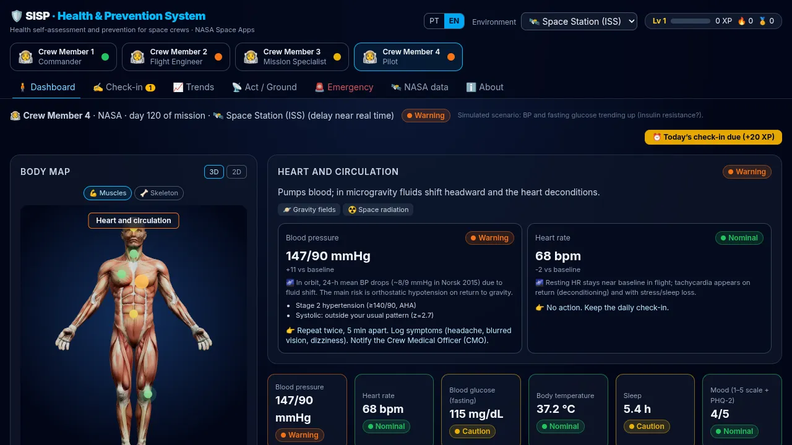
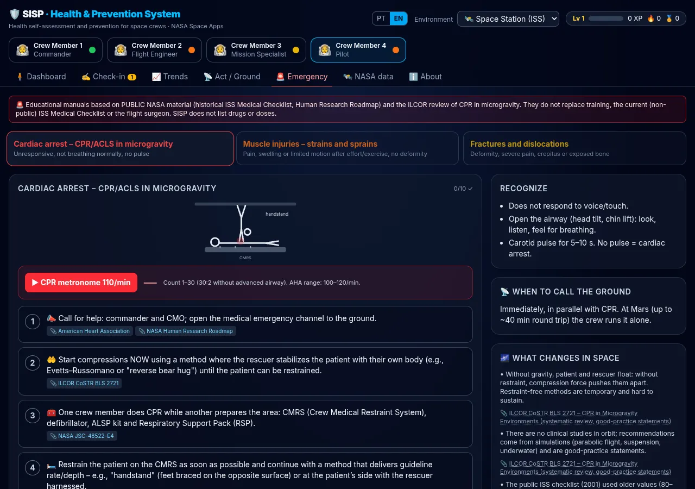
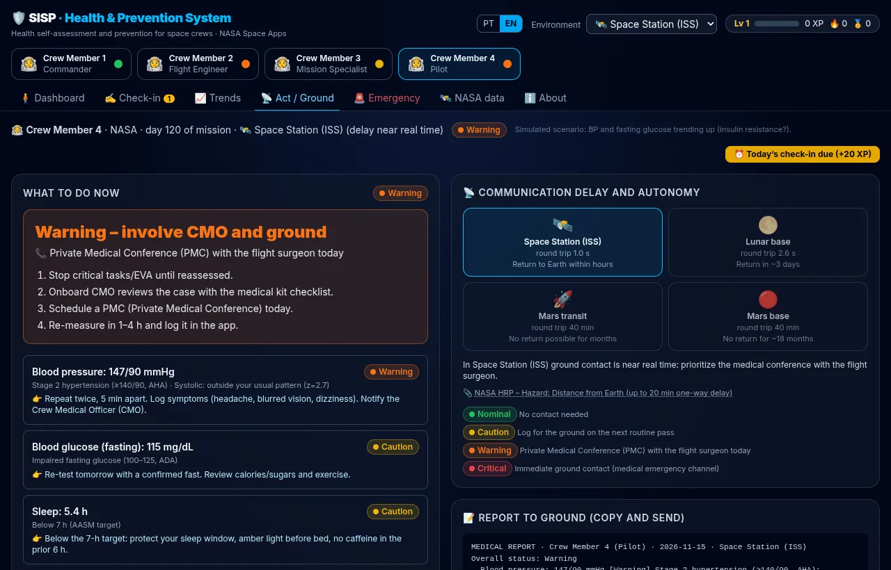

<div align="center">

# 🛡️ SISP — Sistema de Saúde e Prevenção

**Autoavaliação de saúde e guia de emergência para astronautas, offline-first**

NASA Space Apps Challenge · *Create Health Monitoring Software for Astronauts on Space Missions*

**🚀 Demo ao vivo: [elsesystems.github.io/SISP](https://elsesystems.github.io/SISP/)**

Português · [English](README.md)


</div>

> [!WARNING]
> **O SISP não é dispositivo médico nem protocolo da NASA.** É um protótipo educacional de hackathon.
> As faixas clínicas vêm de diretrizes terrestres publicadas (AHA, NHLBI, ADA, CDC, AASM, PHQ-2) e de material público da NASA;
> os limites operacionais usados pelos flight surgeons da NASA não são públicos. Os limiares de linha de base pessoal são heurísticas do protótipo e os dados da tripulação são **simulados**.
> Os manuais de emergência resumem documentos públicos da NASA e não substituem treinamento, o checklist médico atual da ISS (não público) nem o flight surgeon.



## Visão geral

Numa missão longa, a tripulação nem sempre pode esperar pelo solo. Com o SISP, cada astronauta registra seis indicadores vitais em menos de um minuto, vê num corpo 3D **qual sistema está saindo do normal** e recebe uma resposta clara para duas perguntas: **o que eu faço agora?** e **quando chamo o solo?** A resposta muda conforme o local da tripulação: ISS (contato quase em tempo real), Lua ou Marte (atraso de até ~20 min por trecho).

## Funcionalidades

| | |
|---|---|
| 🧍 **Corpo 3D interativo** | Modelos `.glb` muscular e esqueleto (React Three Fiber). Gire, dê zoom e clique nos pontos de cada região, coloridos por severidade. Há também um mapa 2D em SVG como alternativa. |
| ✍️ **Check-in diário** | Pressão arterial, frequência cardíaca, glicemia de jejum, temperatura, sono e humor (escala 1–5 + PHQ-2), cada um com instruções de medida. |
| 🧠 **Avaliação em duas camadas** | (1) limites absolutos de diretrizes publicadas; (2) desvio da **linha de base pessoal de 14 dias** (z-score). Resultado: *Nominal / Atenção / Alerta / Crítico*. |
| 🌡️ **Febre relativa** | Em voo, a temperatura de repouso sobe ~1 °C (Stahn 2017). Por isso o SISP avisa com +0,8 °C acima da *sua* base de voo, mesmo abaixo de 38 °C. |
| 📡 **Escalonamento ciente do atraso** | Orientação que se adapta ao ambiente (ISS, base lunar, trânsito para Marte, base em Marte), diagrama animado do sinal Terra ⟷ destino e escada de escalonamento N0→N3. |
| 📝 **Relatório ao flight surgeon** | Relatório compacto em **texto ou JSON** (chaves curtas, poucas centenas de bytes): sinais vitais, alertas, radiação incluindo a dose de evento solar, osso, PVT, pulso pela câmera, ações já tomadas e observações. Copiar, baixar `.json` ou "transmitir" (simulado) para ver quando chega ao solo e a **resposta mais cedo** (ida e volta + ~30 min de análise). |
| ☢️ **Alerta real de tempestade solar (DONKI)** | Um evento de partículas solares real do DONKI (o SEP mais recente da API ao vivo, ou replay do evento real GOES >100 MeV de maio/2024 após uma erupção X5.8) dispara um alerta vermelho **"vá para o abrigo"**. A dose do evento sobe ao vivo na barra de radiação até a tripulação tocar *Estou no abrigo*; o evento entra na timeline do dia e no relatório. |
| 📷 **Pulso pela câmera (PPG)** | Ponta do dedo na câmera (lanterna no celular): onda ao vivo, medidor de qualidade do sinal e **estimativa** de BPM por autocorrelação, comparada com a FC do check-in. Há um sinal de demonstração sem câmera. O vídeo não sai do aparelho. |
| ⚡ **Teste de vigilância PVT** | Teste de tempo de reação estilo PVT-B (demo 30 s, 1, 2 ou 3 min; intervalo 1–4 s; lapso ≥ 355 ms), comparado com a **base pessoal de PVT** e cruzado com a média de sono de 3 noites → status de fadiga que alimenta a região do cérebro e o status geral. |
| 🗓️ **Timeline do dia de missão** | Dia no estilo ISS em horário da estação (GMT): check-in em jejum, pulso pela câmera, exercício ARED/CEVIS, PVT à tarde, relatório da noite, pré-sono. Estados agora/atrasado, conclusão automática pelos dados, lembretes no app (+ notificações do sistema opcionais) e faixa de 7 dias com erupções reais do DONKI. |
| 🚨 **Manuais de emergência** | Passo a passo para **parada cardíaca (RCP/ACLS em microgravidade)**, **lesões musculares** (distensão/entorse) e **fraturas/luxações**, com ilustrações, metrônomo de RCP a 110/min e a fonte citada em cada passo. |
| 📈 **Tendências** | Valor atual + delta vs base no cabeçalho, faixa nominal + limites tracejados das diretrizes, hover sincronizado entre todos os gráficos, PA e glicemia em largura total. |
| ☢️ **Radiação e osso** | Dose acumulada comparada ao limite de carreira de 600 mSv (NASA-STD-3001) e perda óssea estimada (1–1,5 %/mês). |
| 🛰️ **Dados reais da NASA** | Glicemia da tripulação Inspiration4 (OSDR OSD-575), clima espacial do DONKI com um treino baseado na tempestade solar real de maio de 2024, e taxas de dose publicadas do RAD. |
| 🌐 **PT / EN** | Interface completa em português e inglês. O idioma é detectado pelo navegador e pode ser trocado a qualquer momento. |
| 🎮 **Gamificação leve** | XP, níveis, sequências e medalhas por check-in, PVT, pulso pela câmera, abrigo e relatórios. |
| 📴 **Offline-first** | Roda inteiro no navegador e salva em `localStorage`. Sem backend e sem rastreamento. |

<table>
<tr>
<td></td>
<td></td>
</tr>
</table>

### Demo guiada e onboarding

- **▶ Demo** (botão no topo ou `/#demo`): tour guiado de ~90 s com um clique, que conduz o app sozinho (ISS → febre relativa → tendência de isolamento → trânsito para Marte → **tempestade solar real do DONKI + abrigo** → autotestes → escalonamento ciente do atraso → manuais de emergência → dados da NASA). A demo não deixa rastro (o evento solar e a dose são descartados ao sair). Teclas: `←`/`→` passo, `espaço` pausa, `Esc` sai. Ao sair, a visão anterior é restaurada.
- **Briefing da missão** (primeira abertura, botão `❔` ou `/#intro`): onboarding de 3 cartões / 30 s explicando o problema, como o SISP funciona e por que importa.
- **5 hazards no corpo**: escolha um dos cinco hazards do NASA HRP e o corpo 3D acende todos os órgãos afetados (anéis de sonar), com *o que faz / o que o SISP mede / contramedida* e a fonte.
- Relógio **MET** (tempo decorrido de missão) e tema visual de espaço profundo (CSS puro, funciona offline).

### Como testar cada funcionalidade

| Funcionalidade | Onde | Faça isto |
|---|---|---|
| Alerta de tempestade solar | **🗓️ Dia de missão** → *Injetar SEP real*, ou **🛰️ Dados NASA** → *Disparar alerta* | Veja o banner vermelho e a dose subindo na barra de radiação; toque **Estou no abrigo** (taxa ×0,25, contador de dose evitada) e depois **Liberação do solo**. Troque antes para *Trânsito para Marte* para um evento Crítico. |
| Pulso pela câmera | **⚡ Autotestes** | *Medir com a câmera* (celular: câmera traseira + lanterna; notebook: dedo na webcam com uma luz atrás) ou *Sinal de demonstração*. 20 s → *Salvar estimativa*. Requer `https` ou `localhost`. |
| PVT | **⚡ Autotestes** | Escolha *30 s demo* ou *3 min · PVT-B* e aperte **Espaço** / toque quando o contador aparecer. Selecione o Tripulante 2 para ver fadiga ligada ao sono curto. |
| Relatório ao flight surgeon | **📡 Agir / Solo** | Marque as ações tomadas, escreva uma observação, alterne TEXT/JSON, *Copiar*, *⬇ .json*, *Transmitir (simulado)*. Compare ISS e Marte. |
| Timeline do dia | **🗓️ Dia de missão** (e a faixa *Hoje* no Painel) | Itens vencendo brilham e geram lembrete; check-in / PVT / pulso / relatório se completam sozinhos. *Ativar notificações* para alertas do sistema. |
| Idioma | `PT` / `EN` no topo | Todas as telas, o relatório e as legendas da demo mudam. |

### Tripulação simulada

Quatro tripulantes anônimos, com 30 dias de dados gerados por seed fixa. Cada um ilustra um cenário:

| Tripulante | Função | Cenário |
|---|---|---|
| Tripulante 1 | Comandante | Estável, serve de referência saudável |
| Tripulante 2 | Engenheiro de voo | Privação de sono + humor baixo (PHQ-2 positivo) |
| Tripulante 3 | Especialista de missão (CMO) | Febre relativa abaixo de 38 °C |
| Tripulante 4 | Piloto | Pressão e glicemia de jejum subindo |

## Como rodar

Requisitos: **Node.js ≥ 20.19** (veja `.nvmrc`). Python 3.9+ é opcional e só serve para atualizar os dados.

```bash
npm install
npm run dev        # http://localhost:5173
```

| Script | O que faz |
|---|---|
| `npm run dev` | Servidor de desenvolvimento (Vite) |
| `npm run build` | Checagem de tipos (`tsc -b`) + build estático em `dist/` |
| `npm run preview` | Serve o build de produção |
| `npm run lint` | Lint com oxlint |
| `npm run check` | Lint + build (portão de CI) |
| `npm run data` | Baixa de novo os dados da NASA para `public/data/` (só biblioteca padrão do Python) |

**Deep links para demo:** `#dashboard`, `#checkin`, `#trends`, `#ground`, `#emergency`, `#nasa`, `#about`.

### Deploy

O Vite usa `base: './'`, então o `dist/` funciona em qualquer hospedagem estática:

- **Vercel**: `vercel.json` incluído.
- **GitHub Pages**: workflow em `.github/workflows/pages.yml` (roda a cada push na `main`).

## Arquitetura

```
src/
├── lib/
│   ├── knowledge.ts    # faixas clínicas, fontes, hazards, regiões do corpo, ambientes
│   ├── assessment.ts   # avaliação por diretriz + linha de base, radiação, osso
│   ├── escalation.ts   # "quando chamar o solo" por severidade × atraso
│   ├── emergency.ts    # manuais de emergência (passos + citações NASA/ILCOR/AHA)
│   ├── spaceWeather.ts # DONKI (snapshot + API ao vivo), cenário de SEP, dose do evento
│   ├── ppg.ts          # processamento do sinal PPG da câmera (reamostragem, filtro, autocorrelação)
│   ├── schedule.ts     # timeline do dia de missão + estados das tarefas
│   ├── report.ts       # relatório compacto ao flight surgeon (JSON + texto)
│   ├── motion.ts       # variants compartilhadas do Framer Motion
│   ├── crew.ts         # tripulação simulada (seed fixa, sinais vitais + histórico de PVT)
│   ├── store.ts        # estado Zustand persistido, XP / medalhas, idioma
│   └── i18n.ts         # helper PT/EN mínimo, sem dependência
├── components/         # Dashboard, Body3D, BodyMap, Checkin, Trends, Ground, CommLink,
│                       # FlightSurgeonReport, SolarAlert, MissionTimeline, Reminders,
│                       # SelfTests, PulseCam, Pvt, Emergency, NasaData, About, ui
public/
├── models/             # modelos 3D otimizados (~1 MB cada)
└── data/               # dados estáticos da NASA (JSON)
scripts/
└── fetch_nasa_data.py  # OSDR OSD-575 + DONKI + referência de radiação → public/data
```

Todo número exibido no app tem origem rastreável. As faixas e ações estão em `knowledge.ts` e os passos de emergência em `emergency.ts`, cada um com link para a fonte na aba **Sobre**.

### Modelos 3D

Os originais exportados do Tripo (~65 MB e ~2 milhões de triângulos cada) **não são versionados**. Eles foram otimizados com o [glTF-Transform](https://gltf-transform.dev/):

```bash
npx @gltf-transform/cli optimize "human muscular 3d model.glb" public/models/human-muscular.glb \
  --simplify-ratio 0.06 --simplify-error 0.002 --texture-size 1024 --texture-compress webp --compress meshopt
```

O resultado tem ~117 mil triângulos, texturas WebP de 1024 px e ~1 MB por modelo. O decoder meshopt vem com o three.js, então os modelos carregam offline. A visão 3D é carregada sob demanda e cai para o mapa 2D quando não há WebGL.

## Manuais de emergência: fontes

Os passos foram parafraseados apenas de material público. **O app não indica medicamentos nem doses.**

- [NASA JSC-48522-E4 — ISS Medical Checklist (versão pública de 2001, arquivada)](http://web.archive.org/web/20230519222418/https://www.nasa.gov/centers/johnson/pdf/163533main_ISS_Med_CL.pdf): RCP/ACLS no Crew Medical Restraint System, distensões/entorses, fraturas
- [NASA NTRS — validação dos procedimentos do checklist médico da ISS](https://ntrs.nasa.gov/citations/20000026308)
- [ILCOR CoSTR BLS 2721 — RCP em microgravidade](https://costr.ilcor.org/document/bls-2721-cpr-in-microgravity-environments)
- [AHA — diretrizes de SBV/SAV em adultos](https://cpr.heart.org/en/resuscitation-science/cpr-and-ecc-guidelines/adult-basic-and-advanced-life-support): 100–120/min, 5–6 cm, 30:2
- Evidências do NASA Human Research Roadmap: [Parada cardíaca súbita](https://humanresearchroadmap.nasa.gov/Evidence/medicalConditions/Sudden_Cardiac_Arrest.pdf), [Lesão nas costas](https://humanresearchroadmap.nasa.gov/Evidence/medicalConditions/Back_Injury.pdf), [Luxação de ombro](https://humanresearchroadmap.nasa.gov/Evidence/medicalConditions/Shoulder_Dislocation.pdf), [Fratura lombar](https://humanresearchroadmap.nasa.gov/Evidence/medicalConditions/Lumbar_Spine_Fracture.pdf)
- [NASA HRP Evidence Report — risco de fratura óssea (2024)](https://ntrs.nasa.gov/api/citations/20240005190/downloads/2024%20FINAL%20HRP-F07-ERft%20R2%20Fracture.pdf)

O checklist de 2001 usa valores de RCP desatualizados (80–100/min, 15:2, golpe precordial). O SISP sinaliza isso e segue as diretrizes atuais da AHA/ILCOR.

## Dados da NASA usados

| Dado | Uso no app | Fonte |
|---|---|---|
| Painel metabólico Inspiration4 (glicose, 4 tripulantes, L-92 → R+194) | Gráfico real pré/pós-voo | [NASA OSDR OSD-575](https://osdr.nasa.gov/bio/repo/data/studies/OSD-575) |
| DONKI — SEP, erupções, CMEs | Painel de clima espacial, alerta de SEP na tripulação ("vá para o abrigo"), faixa de 7 dias de erupções na timeline. Snapshot embutido offline; atualizado pela API ao vivo (CORS liberado) quando online | [NASA CCMC DONKI](https://ccmc.gsfc.nasa.gov/tools/DONKI/) |
| Taxas de dose: Curiosity RAD (superfície de Marte e cruzeiro), ISS, Chang'e-4 (Lua) | Medidor de radiação por ambiente | Hassler 2014 · Zeitlin 2013 · PMC10919966 · Zhang 2020 |
| Limite de carreira de 600 mSv | Meta do medidor de radiação | [NASA-STD-3001](https://www.nasa.gov/reference/4-0-human-performance/) |
| Cinco hazards, perda óssea, atraso de comunicação | Conteúdo educativo e escalonamento | [NASA HRP hazards](https://www.nasa.gov/hrp/hazards/) |

### Faixas clínicas (terrestres)

- **Pressão:** AHA < 120/80 normal, > 180/120 crise; baixa < 90/60 (NHLBI)
- **FC de repouso:** 60–100 bpm (AHA)
- **Glicemia de jejum:** < 100 normal, ≥ 126 faixa de diabetes, < 70 hipoglicemia, < 54 grave (ADA)
- **Temperatura:** febre ≥ 38 °C (CDC); base de voo +~1 °C (Stahn 2017)
- **Sono:** ≥ 7 h (AASM); média na ISS ~6,1 h (Barger 2014)
- **Humor:** PHQ-2 ≥ 3 = rastreio positivo (Kroenke 2003)

## Privacidade

Todos os dados ficam no dispositivo (`localStorage`). Não há servidores, analytics nem chaves de API. O `npm run data` acessa apenas endpoints públicos da NASA.

## Licença

[MIT](LICENSE) © 2026 Samuel Nogueira. Os dados e documentos da NASA citados são públicos e seguem os termos originais.
